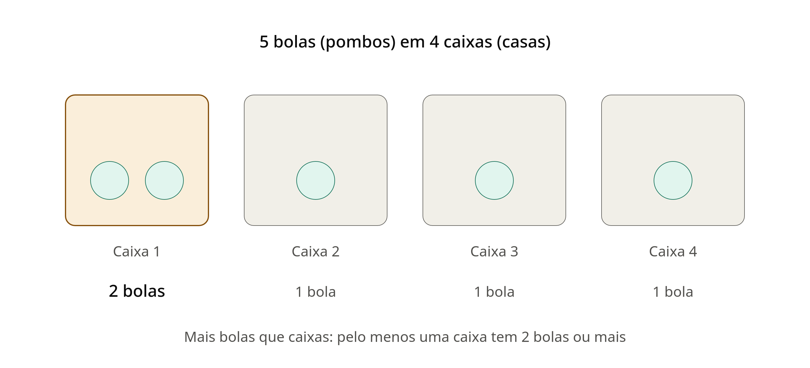

# Teoria da casa dos pombos

Nesse pricipio dos pombos nos temos um principio a ser seguido que é
com 5 bolas e 4 caixas, o princípio garante que pelo menos uma caixa tem no mínimo 2 bolas. 
Ele não garante que uma caixa fique com as 5, mas isso pode acontecer, porque nada impede.
Ou seja a teoria nao tem uma regra clara sobre como voce vai distribuir, onde cada bola vai
ele pelo menos vai garantir que 1 das caixa vai possuir no minino 2 bola, podendo conter mais bolas