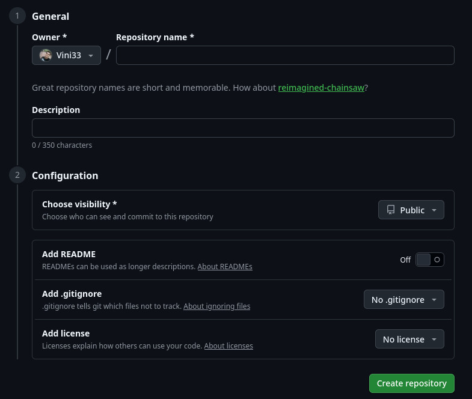

# GIT ESTUDO

## erros
    ao criar um repositorio no github temos que criar sem o readme, tem que ser completamente vazio, caso criamos ele com
    readme vai da erro, a opcao add readme precisa esta off como vem no padrao
