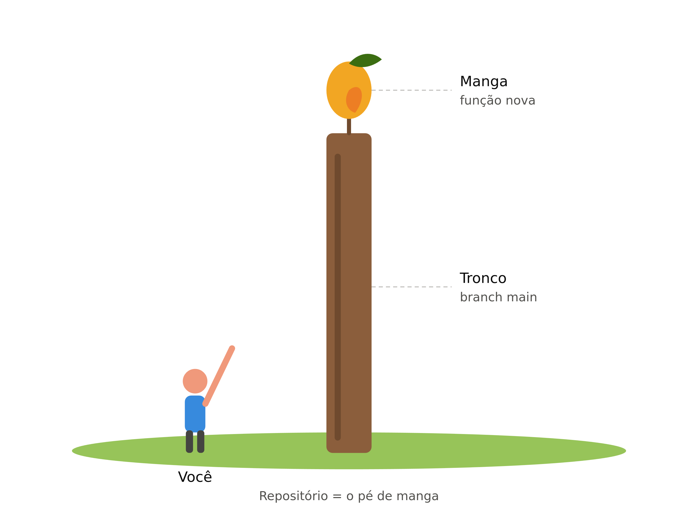
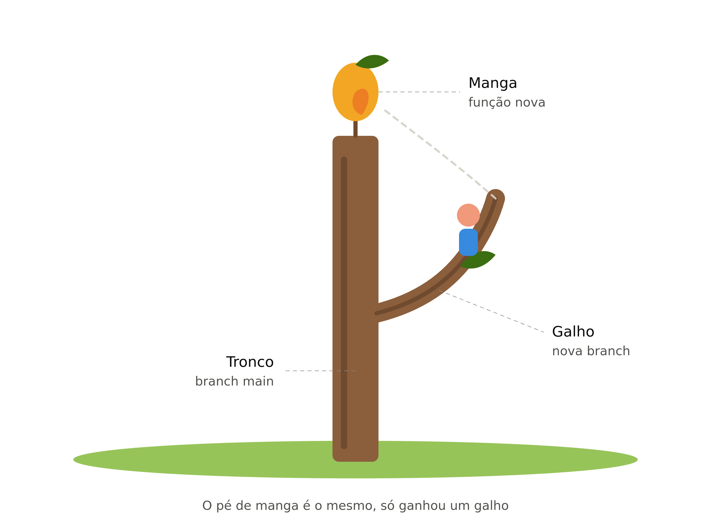
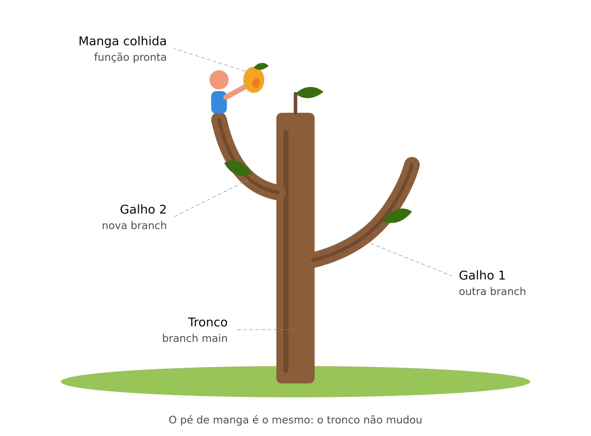
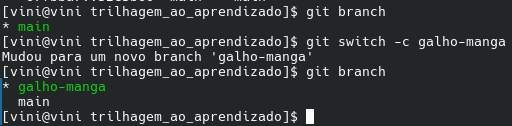
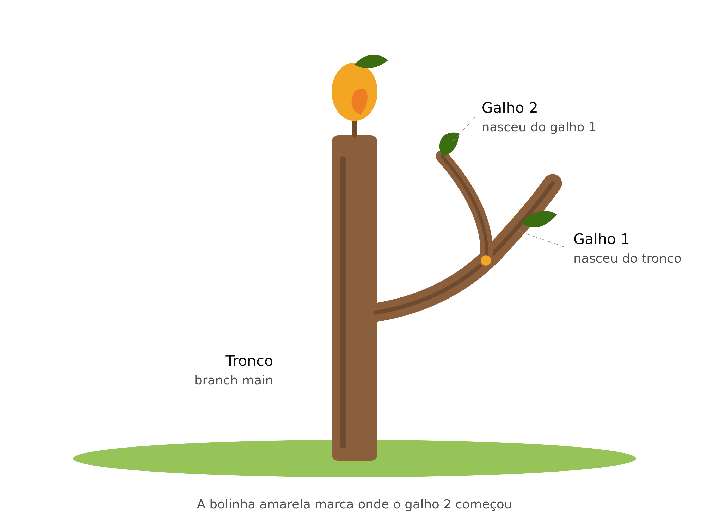

# O que é uma branch?

Imagine que voce esta em uma arvore e quer pegar uma manga que esta um pouco mais alta que voce
pra isso voce vai ter que ir subindo de galho em galho ate chegar na manga, agora vamos dizer que esse 
pe de manga e o seu repositorio, entao ele nunca muda o pe de manga nunca muda voce so ficou mudando
de galho em galho ate conseguir pegar a manga, a manga e como se fosse um teste uma funca que voce quer
implementar mas nao sabe se vai fica bom e caso voce se arrependar de pegar a manga(funcao), voce pode simplesmente
volta pro galho anterio que vai esta como era antes de chegar na manga(funcao),

e aqui que voce olha pensa e imagina eu quero implementar uma nova funcao, mas nao quero baguncar oque eu ja tenho feito

e ai que branch entra, voce pode criar um galho a partir do que voce ja tem feito sem mexer direto na base
basta voce criar uma nova branch

apos conclui oque pensa voce pode decidir se implementar esse novo galho na main enxerta ele na arvore bem dizer ou
se nao voce pode corta ele e jogar fora, remover a branch nao mexer na arvore principal, adicionar uma nova branch
vai ramificar(juntar) o codigo, vai fazer o galho fazer parte da arvore principal

## codigo

 - Voce gostou e quer implementar essa nova branch na main(arvore principal)
   - `git switch main` | voce sai da branch e vai pra main(arvore principal)
   - `git merge galho-da-manga` | aqui voce junta o galho a arvore principal ou a outro galho usando o `merge`

 - voce nao gostou da branch e quer jogar fora
   - `git switch main` | voce sair da branch e vai pra main(arvore principal)
   - `git branch -D galho-da-manga` | aqui voce deleta ela 

 - criando uma nova branch
  - `git switch -c outro-galho` | assim voce criar uma nova branch(galho) e ja entra logo nele
    - `switch` | trocar de branch
    - `-c` | de create (criar), ou seja, cria a branch nova
    - `outro-galho` | o nome que você escolheu para ela

 - vendo as branch que voce tem
   - `git branch` | mostra a lista de branch que voce tem
   - `*` | mostra em qual delas voce ta

 - mudar de branch 
   - `git switch galho-branch` | entra na branch escolhida(galhos)
   - `git switch main`  | vai direto na main(arvore principal)

## branch a partir de outra branch

voce talvez se pergunto posso criar uma branch a partir de outra, ou seja um galho a partir do outro galho
voce pode fazer isso.

mas e bom recapitular alguns entendimentos, digamos que voce fez o commit 3 antes de criar esse novo galho
agora voce criou o novo galho, e por algo motivo deciciu fazer mais um commit 4 ja depois do galho criado
como voce fez isso, esse novo galho so vai possuir os commit 3 pra tras esse commit 4 nao esta presente nesse
novo galho, ou seja se voce criou uma branch(A) e apos cria essa branch(A), voce adicionou uma funcao na branch(B) a branch(A) 
nao vai receber essa funcao, pra que voce possa fazer a branch(A) ter essa nova funcao, voce precisar unir elas
usando o merge como visto a cima no codigo

## Ligando sua branch ao github

tava quase esquecendo pra toda branch nova que voce criar e quiser commita ela no seu repositorio usando 'git push'
voce primeiro tem que "liga" essa branch no github, porque ela esta local apenas no seu computador e o github nao sabe dela,
apos voce criar a branch usando o comando acima, voce "liga" ela ao github usando esse comando

 - `git push -u origin nome-da-branch` | aqui voce "liga" a sua branch local ao github
   - `origin` | endereco do github
   - `nome-da-branch` | nome da branch a qual voce vai informa
   - `-u` | grava a ligacao entre as duas

depois desse comando ai sim voce pode fazer os 'git push' normalmente

caso voce veja esse comando tambem `git push -u origin HEAD` e a mesma coisa do de cima
oque muda e apenas que voce usou o nome HEAD, mas o HEAD no git informa a branch que voce esta usando
no momento, vai que voce esquece o nome da branch mas tem certeza que esta usando a branch voce digita
HEAD  e a sua branch ja esta ligada no github.

## Juntando a branch pelo GitHub

Também dá para juntar o galho à main sem usar o terminal, com um Pull Request:

- `git push -u origin nome-da-branch` | envia a branch ao GitHub
- No site: **Compare & pull request → Create pull request → Merge pull request**
- `git switch main` e `git pull` | atualiza a main no seu computador
