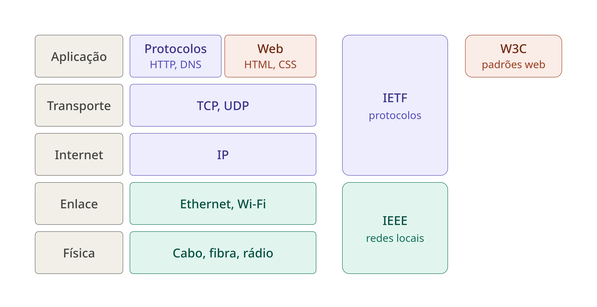
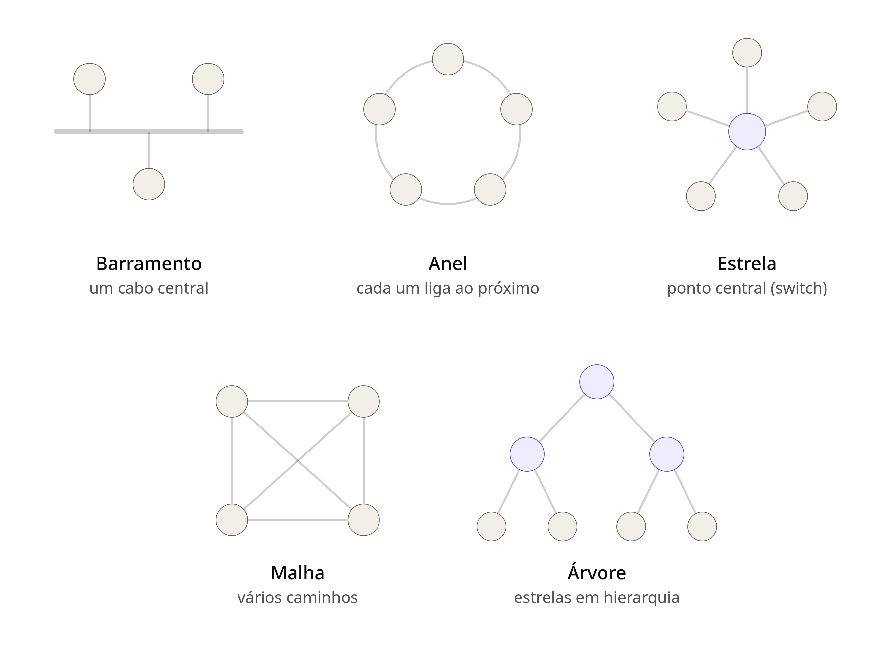

# Comutacao de Pacotes e Tecnologias de Rede

Comutacao = Comutação é a lógica de encaminhar pacotes de nó em nó até o destino. Ela não é o meio físico
mas é realizada pelos equipamentos de rede.

Pacotes = Pacote é a unidade de dados enviada pela rede. 
Ele é composto por um cabeçalho (origem, destino, tamanho e informações de controle)
 e pela carga útil (o conteúdo a ser entregue), também conhecida como payload.

 

## Comutacao de Pacotes

 - Comutacao de pacotes
  - Na comutação de pacotes, os dados são divididos em pacotes e encaminhados
   de nó em nó. Com isso, vários computadores podem compartilhar os mesmos enlaces
    físicos, pois a capacidade só é usada quando há pacotes a transmitir.

##  Organizacoes e suas camadas de protocolos

cada organizacao e padronizacao concentra-se em camadas especificas da pilha de protocolos

## Topologias em redes LAN

Topologia é a forma como os dispositivos de uma rede estão organizados e ligados entre si. 
Existe a topologia física (como os cabos e equipamentos estão realmente dispostos) e a lógica (como os dados circulam).

Os círculos cinza são os computadores e os roxos são equipamentos centrais (switches).

**Barramento**: todos ligados a um único cabo. Se ele falha, a rede toda cai.
**Anel**: cada computador liga ao próximo, formando um círculo.
**Estrela**: todos ligados a um switch central. É a mais usada nas LANs de hoje.
**Malha**: cada dispositivo se liga aos outros, criando vários caminhos. Aqui está a versão completa (todos com todos), mas existe também a malha parcial.
**Árvore**: várias estrelas ligadas em hierarquia, como switches conectados a outro switch no topo.

cada topologia tem a sua vantagem e desvantagem, a mais comum hoje em dia e a topologia estrela, 
Na topologia estrela, todos os computadores se conectam a um equipamento central (switch). 
Cada um funciona de forma independente: se um cabo ou computador falha, os outros não são afetados. 
A desvantagem é que, se o equipamento central falhar, toda a rede fica fora do ar.