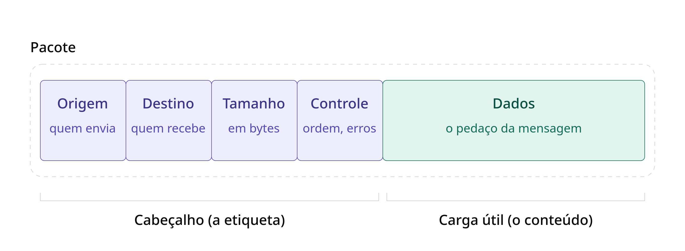

# Comutacao de Pacotes e Tecnologias de Rede

Comutacao = Comutação é a lógica de encaminhar pacotes de nó em nó até o destino. Ela não é o meio físico
mas é realizada pelos equipamentos de rede.

Pacotes = Pacote é a unidade de dados enviada pela rede. 
Ele é composto por um cabeçalho (origem, destino, tamanho e informações de controle)
 e pela carga útil (o conteúdo a ser entregue), também conhecida como payload.

 